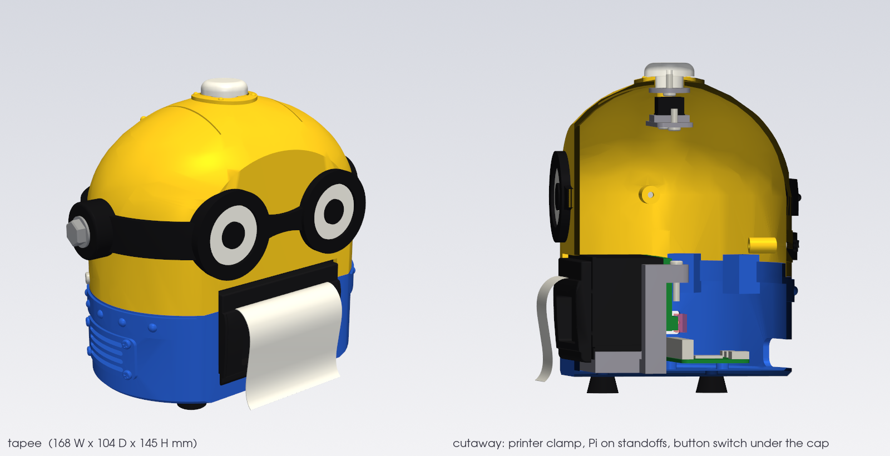
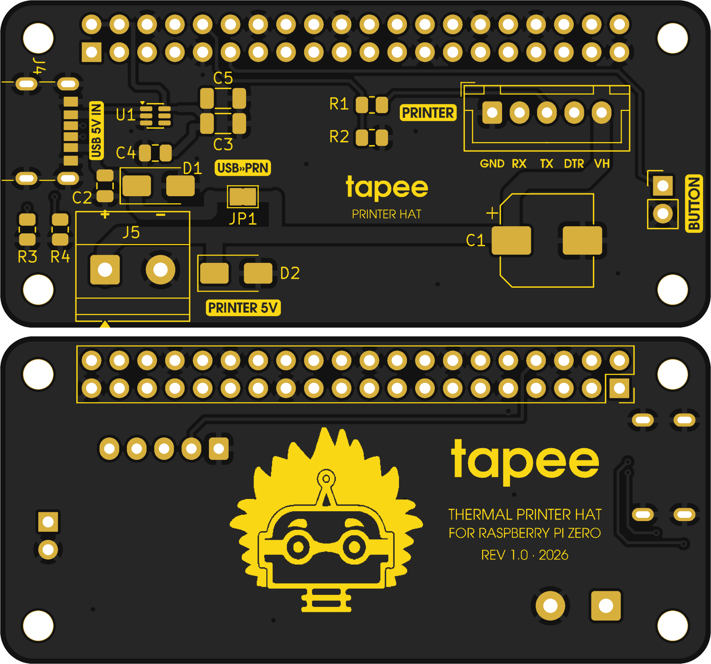

# tapee

tapee is a small internet-connected robot that prints short snippets on thermal paper. A Raspberry Pi Zero drives a 58 mm TTL receipt printer. Press the button on top and it prints a slip.



The print format is still being designed. For now, a button press prints a placeholder ticket with the date and time.

## Hardware

- Raspberry Pi Zero W or Zero 2 W, with header pins
- The tapee HAT (in `pcb/`), which stacks on the Pi
- TTL thermal printer, DP-EH500 / CSN-A2 type (Adafruit-compatible, 384 dots wide, 9600 baud)
- 5 V USB-C supply for the Pi, and a 5 V 2 A supply for the printer
- Momentary push button
- microSD card, 8 GB or larger
- The printed robot body (in `cad/robot/`)

## Connecting the HAT



| HAT connector | Connects to |
| --- | --- |
| J4, USB-C | 5 V supply for the Pi. It feeds the Pi through an ideal diode. |
| J5, screw terminal (PRINTER 5V) | 5 V 2 A supply for the printer. |
| J2, JST-XH 5-pin (PRINTER) | The printer's TTL cable: GND, RX, TX, DTR, VH. |
| J3, 2-pin header (BUTTON) | The push button. |

The printer can draw close to 2 A on dark lines, so by default it has its own supply on J5. To run everything from the USB-C supply instead, close the JP1 solder bridge (USB»PRN) with a blob of solder and use a 5 V 3 A supply.

## Setup

1. Flash **Raspberry Pi OS Lite (32-bit)**. Either:
   - use Raspberry Pi Imager: in the customisation step, set the hostname to `tapee`, create a user, enter your Wi-Fi details, set your time zone, and turn on SSH; or
   - on Linux, without Imager: copy `pi/sdcard/flash.env.example` to `pi/sdcard/flash.env`, fill it in, download the image from [raspberrypi.com](https://www.raspberrypi.com/software/operating-systems/), and run:

     ```sh
     sudo bash pi/sdcard/flash.sh /dev/sdX 2026-10-06-raspios-trixie-armhf-lite.img.xz
     ```

     It refuses non-removable disks, asks you to type the device name before writing, writes the image with `dd`, and then adds the same first-boot settings Imager would. It also takes the serial console off the GPIO pins.
2. Boot the Pi and copy the files to it:

   ```sh
   ssh sury@tapee.local mkdir -p tapee
   scp -p pi/tapee.py pi/tapee.service pi/setup.sh pi/tests/test_printer.py sury@tapee.local:tapee/
   ```

3. On the Pi, run the setup script and reboot:

   ```sh
   cd ~/tapee
   sudo bash setup.sh
   sudo reboot
   ```

   The script installs `python3-serial` and `python3-gpiozero`, turns on the serial port on GPIO 14/15, moves the serial console and Bluetooth off it, and installs `tapee.service` so the button listener starts at boot.

4. Test it:

   ```sh
   python3 ~/tapee/test_printer.py --port /dev/serial0   # prints a test page
   journalctl -u tapee -f                                 # watch the button service
   ```

## Using it

- **Press** the button to print.
- **Hold** it for 5 seconds to shut the Pi down. Unplug it once the green LED stops flashing.

## Repository layout

| Path | What it is |
| --- | --- |
| `pi/` | Runs on the Pi. `tapee.py` is the button listener: it prints a ticket on a press and shuts down on a long hold. `tapee.service` is its systemd unit template, and `setup.sh` is the one-time setup. |
| `pi/sdcard/` | `flash.sh` writes the SD card with `dd` (Linux, no Imager needed); `firstboot.py` writes the cloud-init user, Wi-Fi and SSH settings onto it, from `flash.env`. |
| `pi/tests/` | `test_printer.py` prints a test page (text styles, character set, darkness check); `test_codes.py` prints barcodes and QR codes (needs `segno`). |
| `pcb/` | KiCad 10 project for the tapee HAT, a Pi Zero HAT with USB-C power, the printer connector and the button header. `tapee_hat_render.png` shows both sides. |
| `pcb/lib/` | Project footprint library: the TYPE-C 6P USB-C receptacle (LCSC C456012) and its 3D model. |
| `pcb/art/` | Scripts that generate the silkscreen labels and artwork, and `render.sh`, which redraws `pcb/tapee_hat_render.png` from the board. |
| `cad/robot/` | The printable robot body: CadQuery model, STEP assembly, one STL per part (`stl/`) and renders (`images/`). See its README. |
| `cad/printer/` | Measured CAD model of the DP-EH500 printer, used by the robot model. |
| `cad/render.py` | Renders the robot images from the parts the model writes to `cad/robot/render/`. |

The test scripts default to `/dev/ttyUSB0` for a USB-TTL adapter on a laptop. Pass `--port /dev/serial0` on the Pi.

## Ordering the HAT

The board is 2 layers, 65 × 30 mm. DRC shows no errors and no unconnected items. The 40 warnings are footprint-vs-library differences, empty description fields and the screw-terminal silkscreen at the board edge.

Fabrication outputs are not kept in git. Export them from the saved board into `pcb/fab/` (git ignores it), for example with Konnect's `export_manufacturing_package` for JLCPCB, and zip the Gerber and drill files.

- **PCB:** upload `tapee_hat-gerbers.zip`. Pick black solder mask; the silkscreen is drawn for the yellow look.
- **Assembly (optional):** upload `BOM-tapee_hat.csv` and `CPL-tapee_hat.csv`. Every symbol carries an `LCSC` field, so export the BOM with an LCSC column and JLCPCB matches the parts itself. The resistors, the 10 µF and 22 µF capacitors and the TVS diodes are Basic or Preferred parts; U1, C1 and the connectors are Extended (JLCPCB has no Basic connectors). JP1 is a solder bridge, not a part, and it and the mounting holes are marked do-not-place. Check stock in the BOM tool, and check every part's rotation in the placement preview before you order. J1, the 2×20 socket, sits on the bottom.

## Troubleshooting

- **Nothing prints:** check that the printer has power on J5 (or that JP1 is bridged), and that its cable is in J2 the right way round (GND, RX, TX, DTR, VH).
- **Random characters:** the baud rate is wrong. Hold the printer's feed button while you power it on to print a self-test page that shows the baud rate, then pass `--baud`.
- **Garbage at every boot:** the serial console is still on. Run `sudo raspi-config nonint do_serial_cons 1` and reboot.
