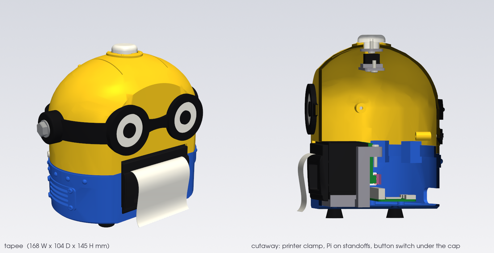
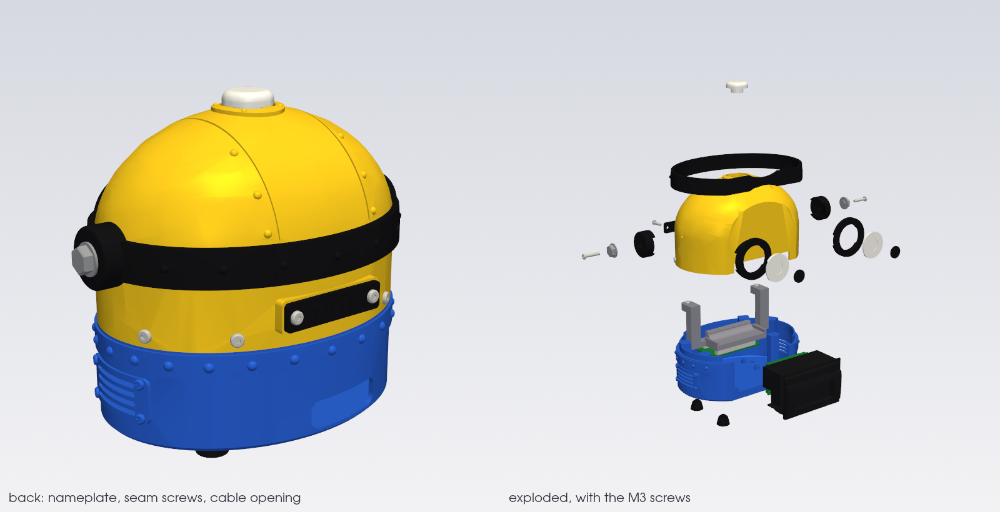

# tapee robot body

The printable body for tapee: a round robot with a dome head and goggle eyes. The printer's front is the mouth.




Size: 168 × 104 × 145 mm, including the ear bolts and the button.

## Files

| File | What it is |
|---|---|
| `tapee_robot.py` | The model. All sizes, gaps and screw positions are named at the top. |
| `tapee_robot.step` | Full assembly with colours, including the printer, the Pi, the switch and the screws. Open it in any CAD program. |
| `stl/` | One STL per printed part, already turned the way it should sit on the print bed. |
| `images/` | The renders shown above. |
| `render/` | Inputs for the renders (not in git; the model writes them). |
| `hat_fit_check.py` | Checks that the tapee HAT PCB, stacked on the Pi, fits in the body with its cables plugged in. Reads the KiCad board, changes nothing. |

To rebuild after changing a size, run this from the repository root:

```sh
~/tools/cadquery/bin/cq-python cad/robot/tapee_robot.py --check
~/tools/cadquery/bin/cq-python cad/render.py cad/robot/render cad/robot/images
```

`--check` lists the overlaps between parts. One is known: about 240 mm³ between the printer's cover and the bottom of the face opening. In the CAD, the cover can't pass through the opening from inside, but the real printer does, so the cover must be narrower near its hinge than modelled. Everything else should show no overlap. The check also prints the cradle's clearances (to the printer's PCB, the shell halves, the Pi and the printer cable) and how far its tabs sit above the towers.

## Printed parts

The file name starts with the colour. "any" means the part is hidden inside, so any colour will do.

| STL | Qty | How it sits on the bed | Supports |
|---|---|---|---|
| `blue_lower_half` | 1 | Floor down | None |
| `yellow_upper_half` | 1 | Seam edge down, dome up | Yes: tree supports inside the dome. The dome is shallow, so most of its inside is flatter than 45°. |
| `black_strap` | 1 | Standing ring | None |
| `black_ring_left`, `black_ring_right` | 1 each | Front face down | None |
| `white_lens_left`, `white_lens_right` | 1 each | Front face down | None |
| `black_pupil_left`, `black_pupil_right` | 1 each | Flat | None |
| `black_ear_left`, `black_ear_right` | 1 each | Outer face down | None |
| `grey_bolt_left`, `grey_bolt_right` | 1 each | Hex top down | None. Print in white, then paint grey. |
| `black_nameplate` | 1 | Back down, letters up | None. A silver paint pen on the letters makes them stand out. |
| `black_foot_x4` | 4 | Wide end down | None |
| `white_button_cap` | 1 | Dome top down | None |
| `any_button_retainer`, `any_switch_holder` | 1 each | Flat | None |
| `any_printer_cradle` | 1 | Floor side down (as the STL is turned) | Yes, but only under the two tabs at the tops of the posts |

Left and right parts are mirror images, so keep them apart.

## Screws (M3 button head)

| Qty | Size | Where |
|---|---|---|
| 4 | M3×8 | Top half to bottom half, just above the seam |
| 2 | M3×8 | Switch holder to the bosses under the dome |
| 1 | M3×8 | Button retainer to the button cap |
| 2 | M3×12 | Nameplate |
| 2 | M3×16 | Ear plates, through the strap into the head |
| 2 | M3×16 | Printer cradle into its towers |

The screws cut their own threads in 2.7 mm printed holes, so don't overtighten them. The ear screws must be button heads, because a socket head is too tall for the hole under the bolt cap.

## Assembly

1. **Feet:** glue the four feet into the holes in the floor.
2. **Pi:** press the Pi Zero W onto the four pins, with its USB ports facing the back opening. Add a dab of hot glue if it's loose. A right-angle micro-USB cable fits best.
3. **Printer:**
   1. Unplug the printer's cable.
   2. From inside, push the printer's cover out through the face opening, so the flange sits against the inside of the face.
   3. Set the cradle in from above. Its floor goes under the printer's paper bucket, its rear lip goes behind the bucket's rounded bottom edge, and its two tabs sit on the towers.
   4. Put the 2 × M3×16 screws through the tab slots into the towers, but leave them loose.
   5. Push the cradle forward until its rear lip presses the printer and the flange is flat against the inside of the face. The slots let it slide 2 mm either way.
   6. Tighten the screws.
   7. Plug the cable back in.
4. **Button:**
   1. Push the white cap's plunger down through the hole in the top.
   2. From inside, screw the retainer disc onto the plunger with an M3×8.
   3. Solder two wires to the switch: one for GPIO17 (pin 11) and one for GND (pin 9), the same as `README.md`.
   4. Set the switch in the holder, with its legs through the slots.
   5. Screw the holder up to the two bosses with 2 × M3×8.
5. **Strap:** slide the strap down over the dome until it sits where the dome meets the body.
6. **Ears:**
   1. Put an ear plate over each strap end.
   2. Screw each one through the plate and the strap into the head with an M3×16.
   3. Glue a bolt cap into each ear's screw hole.
7. **Goggles:**
   1. Glue the rings on; their backs are notched to sit over the strap.
   2. Glue the lenses into the rings.
   3. Glue the pupils into the pockets in the lenses.
8. **Nameplate:** fit it with 2 × M3×12.
9. **Close up:**
   1. Connect the button wires to the Pi with Dupont connectors, so the top half can come off again.
   2. Set the top half on the bottom half's lip.
   3. Fit the 4 seam screws.

To load paper, open the printer's lid from the front. The robot doesn't need to come apart.

## Check before printing

- **Switch height:** the holder is sized for your 12 × 12 mm switch with its white cap on: 10.8 mm from the bottom of the body to the top of the cap (`SWITCH_H`). Leave the cap on. If the button feels pressed all the time, or has too much free play, put M3 washers between the holder and the bosses, or change `SWITCH_H` and reprint the holder.
- **Printer cradle** (2026-11-21, replaces the clamp bars): it carries the printer from below and pushes it forward, so the flange is held against the inside of the face. The printer's back is hollow (thin walls frame open windows onto the motor and rollers), so the cradle only touches the bucket's underside, its sides and its rounded rear-bottom edge.
  - Its floor is 5.7 mm tall: the gap between the robot's floor and the bucket in the model. The model's printer height hasn't been checked with the flange inside. Before printing, fit the printer and measure that gap. If it isn't 5.7 mm, change `PZ` and rebuild, or glue a strip on top of the cradle's floor.
  - The tabs sit 0.2 mm above the towers, so the floor rests on the robot's floor.
  - The towers stay where they were printed (`TOWER_X`, `TOWER_Y`).
- **Printer cable and HAT:** with the flange inside, the printer sits 4.1 mm further back than before. Its plugged-in cable now reaches over the front edge of the HAT, about level with the HAT's top (`hat_fit_check.py` flags it). Check that the plug doesn't press on the HAT, and bend the cable upward if it does.
- **Lid swing:** the lid swing hasn't been tested with this face. Print the lower half first and try it with the printer fitted.
